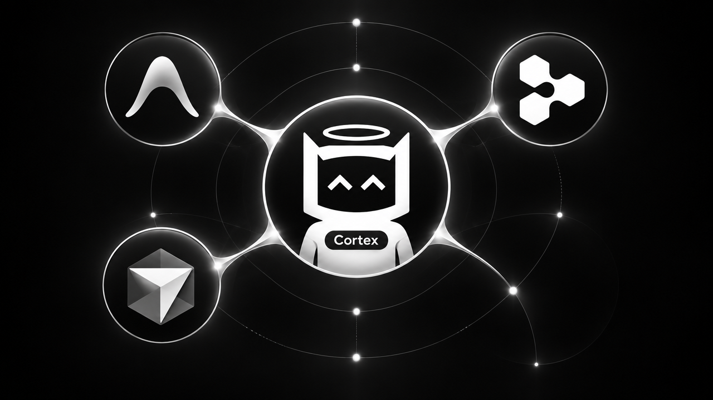
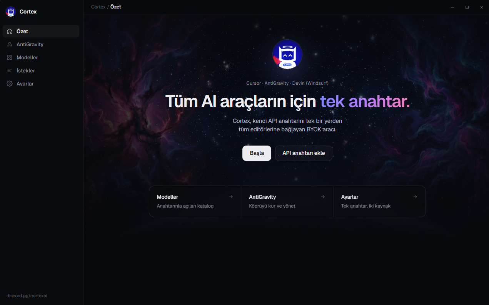

<p align="center">
  
</p>

<h1 align="center">Kendi anahtarın. Kendi modellerin. Editör sana hesap sormasın.</h1>

<p align="center">
  Cortex, Windows’ta oturan küçük bir masaüstü uygulama.<br>
  API anahtarını bir kez koyuyorsun. AntiGravity o anahtarla, senin seçtiğin modellerle çalışıyor.
</p>

<p align="center">
  
</p>

Abonelik penceresine düşmeden, “bu model bu ay kapalı” demeden, aynı anahtarı editörün içinden kullanmak isteyenler için. Hesap oluşturmuyorsun. Cortex’in bir sunucusu yok. Anahtar makinede kalıyor.

---

## Şu an ne çalışıyor

**AntiGravity çalışıyor.** Köprüyü açıyorsun, listeden modeli seçiyorsun, istekler oraya gidiyor. Günlük kullanım bu.

**Cursor henüz çalışmıyor.** Model ekleniyor, köprü açılıyor, sonra istek retry’da kalıyor ve cevap gelmiyor. Bu katman bozuk. Ya düzeltilmesi ya da baştan yazılması lazım. O yüzden kodu AntiGravity’den ayırıp tek klasöre koydum: `providers/cursor`. İçeri giren biri motorun geri kalanına bulaşmadan sadece bunu sökebilir veya onarabilir.

Bu repoyu da onun için bırakıyorum. Kullanan kullansın. Cursor tarafını düzeltmek isteyen de nereden başlayacağını görsün.

## Kurulum

Windows ve Node 20+.

```powershell
npm install
npm start
```

Kurulum dosyası istersen:

```powershell
npm run dist
```

AntiGravity sekmesi, makinede AntiGravity kuruluysa anlamlı. Yoksa uygulama açılır ama o köprünün bağlanacağı bir şey olmaz.

## İçeride ne var

| | |
| --- | --- |
| AntiGravity | Aç, model seç, kullan. Bu taraf hazır. |
| Modeller | Anahtarın ve açık modeller. |
| İstekler | AntiGravity bir şey istediğinde burada görürsün. |
| Cursor | Ayrı klasör, ayrı köprü. Şu an retry’da takılıyor. |
| Ayarlar | Açılışta başlat. Köprüyü kaldırınca AntiGravity kendi haline döner. |

Cursor’u tamamen çıkarmak ya da sadece onu tamir etmek için `providers/cursor/README.md`.

## Neden paylaşılıyor

Bitmiş, cilalı, “her editörde sorunsuz” bir ürün değil. AntiGravity tarafı iş görüyor. Cursor tarafı bilerek ortada duruyor, çünkü orada takıldım ve başkası devam edebilsin istiyorum.

Anahtar, sohbet ve kişisel ayar bu repoda yok. `node_modules` ve derlenmiş `dist` de yok. İndiren kişi kendi anahtarını kendi makinesine girer.
